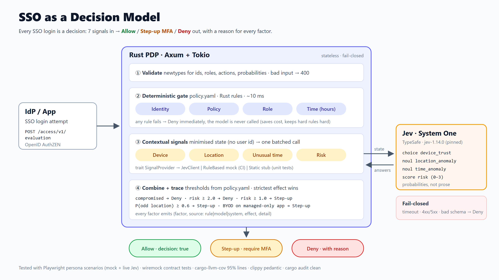

# SSO as a Decision Model

> Every SSO login is a decision.
> `f(Identity, Device, Location, Risk, Role, Policy, Time) → Allow | Step-up MFA | Deny`

A Rust Policy Decision Point (PDP) that speaks **OpenID AuthZEN** and splits the decision in two:

- **Hard rules in Rust**: Identity, Policy, Role and business hours. These checks are deterministic, take about 10 ms, and never call the model.
- **Judgement from [Jev](https://docs.typesafe.ai/api/system-one)** (TypeSafe System One), a decision model that returns *probabilities instead of prose*. It rates Device trust, Location anomaly, Unusual time and overall Risk in **one batched call**.

Every response carries a **decision trace** that records, for each factor, who judged it (rule or model), the effect it had, and why.



🎬 [Playwright walkthrough video](docs/demo/playwright-demo.webm): 6 persona scenarios against the live Jev model, each with its decision trace (40 s).

## Example (real Jev output)

A hijacked-looking login: a rooted phone, a Tor exit node in São Paulo, a Tokyo login 80 minutes earlier, and 14 failed attempts.

```json
{
  "decision": false,
  "context": {
    "outcome": "deny",
    "model": "jev-1.14.0",
    "reason_admin": "device judged 'compromised' (confidence 1.00) …; expected risk 2.87 of 3 (confidence 0.87 …)",
    "trace": [
      { "factor": "role",     "source": "rule",  "effect": "allow",   "detail": "role 'hr' is authorised" },
      { "factor": "device",   "source": "model", "effect": "deny",    "detail": "device judged 'compromised' (confidence 1.00)" },
      { "factor": "location", "source": "model", "effect": "step_up", "detail": "P(implausible location) = 0.97 (step-up at 0.60)" },
      { "factor": "risk",     "source": "model", "effect": "deny",    "detail": "expected risk 2.87 of 3" }
    ]
  }
}
```

The same request from a managed laptop at the Tokyo office returns `allow` with an expected risk of 0.02.

## Design highlights

- **3-valued outcome**: `step_up` covers the middle ground that a plain allow/deny cannot express. The AuthZEN `decision` field stays boolean.
- **Fail-closed**: a timeout, a 401/429/529/5xx response, or any answer that is missing or out of range results in `deny`.
- **Pinned model** (`jev-1.14.0`), so decisions don't change silently.
- **Data minimisation**: the user id is never sent to Jev.
- **Newtypes everywhere**: validation happens at the edge.
- `SignalProvider` trait: the real Jev client, an offline rule-based mock (used in CI and E2E), and a static stub (used in unit tests).

See [docs/design.md](docs/design.md) and [docs/api.md](docs/api.md).

## Run

```bash
# real Jev
export API_KEY_JEV=...            # PowerShell: $env:API_KEY_JEV="..."
./scripts_local/run_server.sh     # or .\scripts_local\run_server.ps1
# offline
./scripts_local/run_server.sh --mock
```

```bash
curl -s localhost:8080/access/v1/evaluation -H 'content-type: application/json' -d '{
  "subject":{"type":"user","id":"alice@example.com","properties":{"roles":["hr"]}},
  "resource":{"type":"app","id":"payroll"},"action":{"name":"read"},
  "context":{"time":"2026-10-30T13:00:00+09:00","device":{"managed":false,"os":"iOS 19"},
             "location":{"country":"JP"},"history":{"recent_logins":[{"country":"JP"}]}}}'
```

Policies live in [app/policy.yaml](app/policy.yaml).

## Test

| | Command | Jev |
|---|---|---|
| Unit + integration (34 tests, 95.5% line coverage) | `cd app && cargo llvm-cov` | stub / wiremock |
| Live contract | `cd app && cargo test -- --ignored` | real |
| Playwright personas (8 tests) | `cd e2e && npm ci && npx playwright test` | mock |
| Playwright personas, live | `E2E_SIGNAL_MODE=jev npx playwright test` | real |
| Recorded demo video → `docs/demo/playwright-demo.webm` | `npx playwright install chromium && E2E_DEMO=1 E2E_SIGNAL_MODE=jev npx playwright test` | real |
| Everything | `./scripts_local/run_tests.sh [--live]` | |

CI runs fmt, clippy (pedantic), coverage (≥ 90%), cargo audit and Playwright in mock mode. Pushing a `v*` tag builds a static `x86_64-unknown-linux-musl` release.

## Stack

Rust 2024 · Axum 0.8 · Tokio · reqwest (rustls) · serde-saphyr · Playwright 1.64 · Jev 1.14 — full list in [docs/dependencies.html](docs/dependencies.html).

## License

MIT
